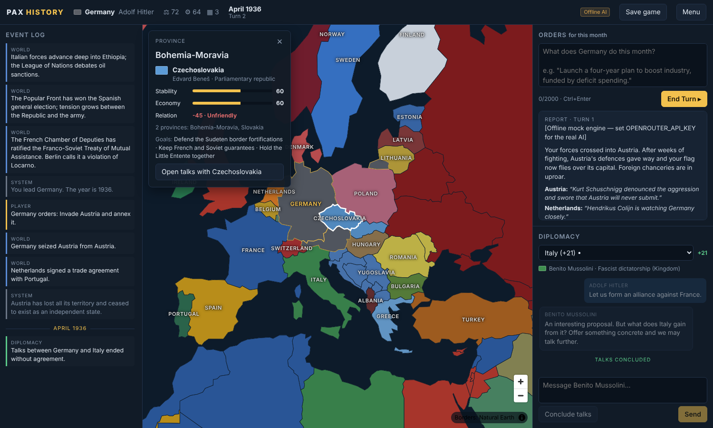

# Pax History

A browser-based, AI-driven alternate-history grand strategy game. Pick a nation and a start date, write your orders in plain language ("remilitarise the Rhineland", "propose an alliance with Japan"), and an LLM game master decides how the world reacts. The map redraws to match.

- **Map:** Natural Earth borders, coloured by owner, rendered with MapLibre GL. Click a region to see its owner.
- **Turns:** each **End Turn** resolves your orders, generates 1–3 moves by AI nations, and advances one month.
- **Diplomacy:** chat with any nation's leader in character. Concluded talks are summarised into the event log.
- **Rules engine:** the AI proposes changes; code validates each one before applying it (unknown provinces and nonexistent nations are rejected and shown to you).
- **Memory:** once the log passes 30 events, older events are folded into a "history so far" paragraph.
- **Save/load:** SQLite. Every turn is autosaved, and you can make named saves.
- **Works offline:** with no API key, a mock engine is used, so you can try the whole loop for free.



## Quick start

Requirements: **Node.js 20.6+** (22 LTS recommended) and npm.

```bash
git clone <this repo> && cd Pax-history-s-
npm install                 # installs root + server + client workspaces
cp .env.example .env        # then edit .env (see below)
npm run dev                 # server on :3001, client on :5173
```

Open **http://localhost:5173**.

### `.env`

```ini
OPENROUTER_API_KEY=sk-or-...          # from https://openrouter.ai/keys  (server-side only)
OPENROUTER_MODEL=openai/gpt-4o-mini   # any OpenRouter model slug that handles JSON well
```

| Variable | Default | Notes |
|---|---|---|
| `OPENROUTER_API_KEY` | *(empty)* | No key means the **offline mock engine** is used. |
| `OPENROUTER_MODEL` | `openai/gpt-4o-mini` | e.g. `anthropic/claude-sonnet-4.5`, `google/gemini-2.5-flash`, `deepseek/deepseek-chat` |
| `OPENROUTER_BASE_URL` | `https://openrouter.ai/api/v1` | Any OpenAI-compatible endpoint works. |
| `AI_MOCK` | `0` | `1` forces the mock engine even if a key is set. |
| `AI_TIMEOUT_MS` | `60000` | Per-request timeout. |
| `PORT` | `3001` | API server port. |
| `DATABASE_PATH` | `./data/pax.sqlite` | Relative to `server/`. |

The key is read only by the Express server (`server/src/config.ts`) and used only in `server/src/ai/client.ts`. The browser calls `/api/*` on your own server and never receives the key. Vite only exposes `VITE_*` variables to the client, so don't rename it to that.

### Other commands

```bash
npm test             # rule-validation unit tests (node:test)
npm run typecheck    # server + client
npm run build        # production build of the client
npm start            # serve API + built client on :3001
npm run geo          # rebuild the province layer from Natural Earth (outputs are committed)
npm run prompts      # regenerate docs/PROMPTS.md from the prompt source
```

## How to play

1. **New game**: pick *Europe, 1936*, a start month, and any of 33 playable nations.
2. **Orders** (right, top): describe what your government does this month. Be as specific or as bold as you like. The engine judges plausibility, so a Baltic state can't conquer the USSR in a month.
3. **End Turn**: read the report (narrative, foreign reactions, and the mechanics applied or rejected). The map and event log update.
4. **Diplomacy** (right, bottom): pick a nation, or click it on the map and choose *Open talks*. Make concrete offers. Leaders act in their own interest. Press **Conclude talks** to record agreements in the log. Open talks are concluded automatically at End Turn.
5. **Save game** in the top bar. **Menu → Load game** lists named saves and autosaved games.

## Project structure

```
.
├── shared/
│   └── types.ts                 # World-state schema + AI contract + API DTOs (types only)
├── server/                      # Node + Express + TypeScript (run with tsx)
│   ├── data/provinces.json      # generated: province ids, names, centroids, neighbours
│   ├── scripts/
│   │   ├── build-geo.ts         # Natural Earth -> provinces.geojson + provinces.json
│   │   └── dump-prompts.ts      # writes docs/PROMPTS.md
│   └── src/
│       ├── index.ts             # Express app (also serves client/dist in production)
│       ├── config.ts            # env -> config (API key stays here)
│       ├── routes/api.ts        # HTTP routes (thin)
│       ├── services/gameService.ts  # turn loop, diplomacy, memory, saves
│       ├── state/
│       │   ├── world.ts         # pure state helpers (relations, dates, lookups)
│       │   ├── summary.ts       # compact world summary for prompts
│       │   └── provinces.ts     # loads province metadata
│       ├── scenarios/
│       │   ├── europe1936.ts    # the preset scenario
│       │   └── index.ts         # scenario registry + initial-state builder
│       ├── ai/
│       │   ├── client.ts        # OpenRouter client, retry/backoff, JSON repair
│       │   ├── prompts.ts       # ALL prompts (engine, diplomacy, summaries, memory)
│       │   ├── engine.ts        # resolveTurn, summarizeHistory
│       │   ├── diplomacy.ts     # chatReply, summarizeTalks
│       │   └── mock.ts          # offline engine with the same JSON contract
│       ├── validation/
│       │   ├── changes.ts       # zod shape check + rule validation/application
│       │   └── changes.test.ts
│       └── db/database.ts       # SQLite (games + saves tables)
├── client/                      # React + Vite + TypeScript + MapLibre GL
│   ├── public/geo/provinces.geojson
│   └── src/
│       ├── App.tsx, main.tsx, styles.css
│       ├── lib/api.ts, lib/format.ts
│       └── components/
│           ├── MainMenu.tsx      # scenario setup + load screen
│           ├── GameScreen.tsx    # layout + request orchestration
│           ├── MapView.tsx       # MapLibre map
│           ├── ProvincePanel.tsx # click-a-region details
│           ├── EventLog.tsx      # left column
│           ├── ActionPanel.tsx   # orders + turn report
│           ├── DiplomacyPanel.tsx
│           └── TopBar.tsx
└── docs/PROMPTS.md              # exact prompts, generated
```

## World-state schema

The entire game is one JSON object (`shared/types.ts`):

```ts
interface WorldState {
  schemaVersion: 1;
  scenarioId: string;
  date: string;                 // "1936-03-01", always the 1st of a month
  turn: number;
  playerNation: NationId;
  nations: Record<NationId, Nation>;
  provinces: Record<ProvinceId, { id; name; owner: NationId }>;
  events: GameEvent[];          // recent log, oldest first
  nextEventId: number;
  historySummary: string;       // "history so far" (memory)
  archivedEventCount: number;
  chats: Record<NationId, ChatThread>;
  lastReport: TurnReport | null;
}

interface Nation {
  id; name; leader; government; capital;
  color: string;                         // flag colour on the map
  relations: Record<NationId, number>;   // -100..100, sparse, kept symmetric
  stability: number; economy: number;    // 0..100
  goals: string[]; persona?: string;     // feed the diplomacy persona
  playable: boolean; minor: boolean; alive: boolean;
}
```

## AI contract and validation

The engine must return:

```json
{
  "narrative": "string",
  "nation_reactions": [{ "nation": "string", "reaction": "string" }],
  "state_changes": [
    { "type": "transfer_province", "province": "string", "to": "string" },
    { "type": "relation_change", "a": "string", "b": "string", "delta": 0 },
    { "type": "stat_change", "nation": "string", "stat": "stability", "delta": 0 },
    { "type": "new_event", "text": "string" }
  ]
}
```

`stat_change` is one addition to the base contract. Without it, nothing in the game could ever move stability or economy.

The reply goes through two layers:

1. **Shape** (zod, `validation/changes.ts`): the reply must be a JSON object with a `narrative` and an array of changes. If it isn't, the call is retried. Retries run up to 3 attempts in total, with exponential backoff (1 s, 2 s, plus jitter). The model is shown its bad output and told exactly what was wrong. HTTP 429/5xx and timeouts are also retried. 401/402/400 fail fast.
2. **Rules** (applied one change at a time, in order, against the live state):
   - `transfer_province`: the province and target nation must exist. The province can't already belong to the target. At most 6 transfers per turn.
   - `relation_change`: both nations must exist and be different, and the delta must be numeric. The delta is clamped to ±40 and the result to −100..100. Relations stay symmetric.
   - `stat_change`: the nation must exist and the stat must be `stability` or `economy`. The delta is clamped to ±15 and the result to 0..100.
   - `new_event`: the text can't be empty. It is capped at 400 characters, and at most 6 events are allowed per turn.
   - Unknown change types are rejected.
   - A nation that loses its last province is marked defunct. It can be revived if it regains land.

IDs and names are both accepted, case- and diacritic-insensitively ("germany", "GER" and "Bohemia-Moravia" all resolve). Rejected changes are never applied. They appear, struck through in red, under **Mechanics** in the turn report, so you can see when the AI tried something impossible.

The exact prompts are in **[docs/PROMPTS.md](docs/PROMPTS.md)**, rendered with real example data. The source is `server/src/ai/prompts.ts`.

## Design decisions

- **One JSON blob per game.** Saving and loading become trivial, the AI sees the same data the UI does, and moving to PostgreSQL means changing the column type to `JSONB` and rewriting the ~10 functions in `db/database.ts`.
- **Provinces = modern admin-0 countries (1:110m).** These are small (180 KB) and fast, and they map cleanly onto 1936 owners: Czechia and Slovakia become Czechoslovakia, the seven Yugoslav successors become Yugoslavia, colonies go to their empires. Russia's Kaliningrad exclave is carved out as *East Prussia* so Germany's 1936 shape is recognisable. Any unassigned country becomes its own minor nation automatically. Finer provinces (admin-1) can be added later without touching the engine.
- **One engine call per turn.** That one call resolves the player's orders and generates the AI nations' moves, so the world's reaction stays coherent with the player's move, at half the latency and token cost of two calls.
- **Compact prompt.** The world is sent as a pipe-separated table rather than JSON (~2.8k tokens for the full 1936 world). Minor nations get one line. Relations are listed only where they matter.
- **Diplomacy is two-step.** The persona chats freely in plain text. A separate, low-temperature "record-keeper" call decides what was actually agreed. This keeps the role-play natural and keeps the bookkeeping honest. An agreement records a commitment but moves no borders. Land changes hands only through the engine.
- **Memory.** When the log passes 30 events, everything except the newest 15 is merged into a ≤220-word history. If that call fails, the turn still succeeds and compaction is retried next turn.
- **Mock engine.** It follows the same contract as the real model, so every code path can be developed and tested without spending tokens.
- **Concurrency guard.** There is one in-flight AI operation per game, so double-clicking End Turn can't resolve a month twice.
- **Map labels as HTML markers.** This avoids an external glyph server, so the map works fully offline.

## Next steps

- **Scenario editor:** paint province ownership on the map, edit nations, leaders, goals and relations, then export the result as a scenario JSON. The scenario format (`server/src/scenarios/types.ts`) is already data-only.
- **Finer provinces:** switch to Natural Earth admin-1 or custom historical provinces (Sudetenland, Danzig, Alsace-Lorraine) and add adjacency-based rules (no conquering non-bordering land without naval access).
- **Multiplayer:** several human nations in one world, with simultaneous order submission and a turn resolved when all players are ready. Add WebSocket push for map and log updates. This needs accounts and moving to PostgreSQL.
- **Community sharing:** publish scenarios and finished timelines, browse and fork others' games, rate them. Make game replays from the event log.
- **Token/credit system:** meter AI usage per user (prompt and completion tokens from OpenRouter's `usage` field), with free daily turns and paid credit packs. Route cheap calls (memory, talks summary) to a cheaper model.
- **Quality:** stream narratives token by token, add armies and war state as first-class data, give AI nations long-term plans that persist between turns, and add an "advisor" that suggests orders.

## License / data

Borders: [Natural Earth](https://www.naturalearthdata.com/) (public domain).
